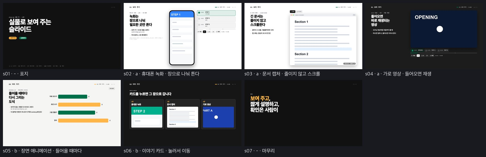

<p align="center"></p>

<h1 align="center">show-me</h1>

<p align="center">
<b>말로 설명하기 전에, 실물을 보여 준다.</b><br>
녹화·캡처·링크를 슬라이드 안에서 틀고 넘기는 HTML 강의 자료. 계획부터 미디어, 덱, 촬영 검사까지.<br>
Claude Code와 Codex에서 쓰는 강의·발표 자료 하네스.
</p>

<p align="center">


</p>

<p align="center"><a href="#무엇을-만드는가">소개</a> · <a href="#왜-show-me인가">이름의 이야기</a> · <a href="#설치">설치</a> · <a href="#만들고-고치는-법">사용법</a> · <a href="#lightplay와-함께">Lightplay와 함께</a> · <a href="docs/guide/README.md">가이드</a></p>

---

## 무엇을 만드는가

- **실물이 도는 슬라이드.** 휴대폰 녹화는 장(chapter)으로 나눠 필요한 곳만 틀고, 긴 문서 캡처는 줄이지 않고 스크롤하고, 실제 페이지는 LIVE 링크로 연다.
- **시간을 지키는 덱.** 구간마다 시간 예산을 정한다. 발표 중 T를 누르면 구간 타이머가 켜지고, 예산에 가까워지면 주황, 넘기면 빨강으로 알려 준다.
- **다시 고칠 수 있는 폴더.** 발표에 들고 가는 `slides/` 하나와 함께 계획(`talk.md`), 미디어 출처(`media.json`), 촬영 검사 기록(`qa/deck/`)을 남긴다.

PPTX·Keynote·Google Slides 파일, PDF 유인물만 만드는 일, 영상 제작 자체는 이 하네스의 범위가 아니다. 영상은 Lightplay가 만들고, show-me는 그 결과를 가져와 슬라이드 안에서 튼다.

## 보기

<p align="center"></p>

*`examples/sample-deck`을 show-me의 검사 도구(`check_deck.py`)로 찍은 7장. 장으로 나눈 휴대폰 녹화, 스크롤하는 문서, 들어오면 재생되는 영상, 들어올 때마다 다시 그리는 도식, 눌러서 이동하는 이야기 카드.* 브라우저로 `examples/sample-deck/slides/index.html`을 열면 직접 넘겨 볼 수 있다.

## 왜 show-me인가

**보여 주라, 말하지 말고. Show, don't tell.**

글쓰기 수업에서 오래 전해 온 말이다. 흔히 체호프가 "달이 빛난다고 말하지 말고, 깨진 유리에 비친 빛을 보여 달라"고 했다며 인용하지만, 그 문장은 체호프가 그대로 쓴 것이 아니다. 1886년 5월 10일 형 알렉산드르에게 보낸 편지의 조언을 나중에 누군가 줄인 말이다. [Quote Investigator의 추적](https://quoteinvestigator.com/2013/07/30/moon-glint/)

편지에서 체호프는 자연을 묘사할 때 작은 세부를 붙잡으라고 했다. 물방앗간 둑 위에서 깨진 병 조각이 작은 별처럼 반짝였다고 쓰면, 달이 떴다고 말하지 않아도 달밤이 된다. 배너의 녹색 병 조각은 그 장면을 그린 창작 이미지다.

보여 주기와 말하기를 나란히 놓는 구분은 퍼시 러벅이 소설 작법을 정리한 책에서 널리 퍼졌다.

> The art of fiction does not begin until the novelist thinks of his story as a matter to be *shown*, to be so exhibited that it will tell itself.
>
> Percy Lubbock, *The Craft of Fiction* (1921). [Project Gutenberg](https://www.gutenberg.org/ebooks/18961)

강의도 같다. "AI가 밤새 만들었습니다"라고 말하는 대신 그 밤의 녹화를 튼다. 결과를 요약하는 대신 실제 문서를 스크롤한다. show-me는 2026년 11월의 20분 강의 덱에서 시작했다. 그 덱의 표지에는 "직접 보여 드리는 자료"라고 적혀 있었다.

## 설치

고정된 [`skills@1.7.4` 설치 도구](https://github.com/vercel-labs/skills/blob/v1.7.4/package.json)는 Node.js ≥ 22.20.0을 요구한다. 이는 설치 도구의 요구 사항이며, 덱 촬영·변환에 필요한 도구는 따로 확인한다.

개별 스킬이 공통 엔진과 스크립트를 함께 쓰므로, 한 프로젝트에 전체 스킬을 설치한다.

```bash
npx skills@1.7.4 add ynginkim/show-me -a claude-code -a codex
```

<details>
<summary>촬영 도구·글꼴·로컬 설치</summary>

GitHub 게시 전에는 로컬 경로로 설치한다: `npx skills@1.7.4 add ~/Documents/harness/show-me -a claude-code -a codex`. 로컬 경로 설치 smoke는 통과했으며, GitHub 경로 설치는 아직 검증하지 않았다.

덱을 찍어 검사하려면 Node 18 이상, 시스템 Chrome, playwright-core가 필요하다. 첫 실행 때 에이전트가 `preflight.py`로 점검하고, 승인하면 설치본의 scripts 폴더 안에 playwright-core를 받는다(npm, 약 14 MB, 브라우저는 내려받지 않음). 영상 변환에는 ffmpeg, 이미지 변환·시트·비교에는 Python Pillow·numpy가 필요하다.

글꼴(Pretendard, JetBrains Mono, SIL OFL)은 새 덱을 만들 때 로컬에서 복사하거나 내려받아 그 덱의 `slides/fonts/`에 둔다. 설치본은 복사본이다. 이 저장소가 바뀌면 다시 설치한다.

</details>

## 만들고 고치는 법

강의 자료를 둘 폴더에서 자연어로 요청한다. `show-me-mode`로 시작한다.

### 처음 만들 때

> 다음 주 신입 직원 대상 20분 사내 강의 자료 만들어 줘. 작업 화면 녹화 세 개가 `sources/`에 있고, 사내 화면이라 현장에서만 보여 줄 거야.

청중, 길이, 발표 화면, 공개 범위처럼 사용자만 아는 것만 묻는다. 구성과 장 수, 색, 애니메이션은 근거를 붙여 스스로 정한다. 끝나면 전 장을 찍고, 찍은 화면을 직접 보며 고친다.

```text
요청 → 청중·시간 계획(talk.md) → 녹화·캡처 변환 → 슬라이드·장면 → 전 장 촬영·검사
                                                          ↓
                       리허설 요청 ← 시트 열람·수정 ← 오류·예산·잘림 확인
```

### 영상 프로젝트에서 시작할 때

> 이 Lightplay 영상 프로젝트로 강의를 열고, 이어지는 슬라이드도 만들어 줘.

영상이 이미 말한 장면과 메시지를 먼저 읽고, 슬라이드는 영상이 짧게 지나간 실물을 자세히 보여 주는 쪽을 맡는다. 영상 파일은 읽기만 하고 덱으로 복사한다.

### 만든 것을 고칠 때

> 2구간을 3분 줄이고, 6번 장 캡처를 새 걸로 바꿔 줘.

고치기 전의 전 장을 먼저 찍어 둔다. 고친 뒤 다시 찍어 장마다 비교하고, 바뀐 장이 고치려던 장과 같은지 확인한다. 덱의 엔진은 요청할 때만 새 버전으로 바꾼다.

### 남는 것

| 결과 | 용도 |
| --- | --- |
| `slides/` | 발표에 들고 가는 폴더. 브라우저로 `index.html`을 연다 |
| `talk.md` | 청중, 구간 예산, 장마다 한 문장과 보여 줄 실물 |
| `slides/media/media.json` | 미디어의 원본 경로·해시와 현장 전용 여부 |
| `qa/deck/` | 전 장 촬영본, 시트, 검사 보고서, 수정 전후 비교 |
| `제작노트.md` | 다시 만드는 명령, 적용한 원칙, 엔진 후보, 남은 사람 확인 |

## 네 가지 원칙

| 원칙 | 실제로 하는 일 |
| --- | --- |
| **청중의 말로** | 슬라이드 글에 내부 이름과 도구 용어 대신 청중이 아는 말을 쓴다. 원문이 증거일 때는 접어 둔다. |
| **실물로 보여 주기** | 녹화·캡처·링크를 먼저 고르고, 화면에 보이지 않는 과정만 도식으로 그린다. 공개 범위가 걸린 실물은 현장 전용으로 다룬다. |
| **내용이 먼저, 엔진은 나중** | 새 동작은 그 덱의 장면 스크립트에 먼저 쓴다. 두 번째 덱이 같은 것을 필요로 할 때 엔진으로 올린다. |
| **찍은 화면으로 판정** | 완료와 수정 범위를 촬영본과 비교로 판정한다. 발표 화면의 가독성과 리허설 시간은 사람에게 남긴다. |

원칙은 각각 [청중의 말](skills/principle-audience-words/SKILL.md), [실물](skills/principle-show-the-real-thing/SKILL.md), [엔진과 내용](skills/principle-content-before-engine/SKILL.md), [찍은 화면](skills/principle-judge-from-shots/SKILL.md)에 적혀 있다.

## Lightplay와 함께

**[Lightplay](https://github.com/ynginkim/lightplay)는 모션그래픽 영상을 만드는 하네스 패밀리 스킬이다.**

<p align="center"><a href="https://github.com/ynginkim/lightplay"></a></p>

*Lightplay 프로젝트 소개.*

강의 앞에 트는 오프닝 영상은 Lightplay가 만들고, show-me는 그 결과를 슬라이드로 잇는다. 두 하네스는 서로의 mode를 부르지 않고 파일로만 연결된다. Lightplay를 설치하지 않아도 그 프로젝트 파일은 읽을 수 있다.

- **영상을 가져온다.** `out/`의 납품 영상(기본은 공유용)·포스터·자막을 덱의 `slides/media/`로 복사하고 원본 해시를 남긴다.
- **장면 시각을 쓴다.** `timeline.json`의 장면 시작 시각을 슬라이드 플레이어의 장(chapter)으로 옮겨, 강의 중에 원하는 장면으로 바로 넘어간다.
- **다시 렌더된 것을 안다.** 영상이 바뀌면 해시가 달라지므로 다시 가져오고, 장면 시각이 바뀐 장만 고친다.

연동 형식은 [Lightplay 파일 계약](skills/link-lightplay/references/lightplay-contract.md)에서 확인할 수 있다.

## 구성

<!-- skillset:summary:start -->
mode 1개, playbook 2개, skill 6개, principle 4개 (설치 단위 11개).

검사: `python3 scripts/check.py .`
<!-- skillset:summary:end -->

| 종류 | 이름 | 하는 일 |
| --- | --- | --- |
| mode | `show-me-mode` | 자연어로 진입한다. 요청과 프로젝트 상태를 보고 playbook을 고르고 결과물·완료·사람 판정을 맡는다 |
| playbook | `create-deck`, `revise-deck` | 새 강의 자료(원자료든 Lightplay 영상이든), 만든 덱 고치기(수정 전후 비교) |
| adapter | `resolve-show-me-tools` | 엔진·템플릿·스크립트를 한 벌 소유하고 `D` 경로, 환경 점검, 새 덱, 엔진 갱신, 공유 계약을 맡는다 |
| skill | `plan-talk`, `prepare-media`, `build-deck`, `check-deck`, `link-lightplay` | 청중·시간 계획, 녹화·캡처 변환, 슬라이드·장면 작성, 전 장 촬영·검사, Lightplay 연결 |
| principle | `principle-audience-words`, `principle-show-the-real-thing`, `principle-content-before-engine`, `principle-judge-from-shots` | 청중의 말로, 실물로 보여 주기, 내용이 먼저, 찍은 화면으로 판정 |

## 사용 전 확인

- 발표 화면에서의 글자 크기와 색, 영상 소리, 실제로 말하는 시간은 사람이 리허설로 확인한다. 촬영 검사 통과만으로 발표 준비가 끝났다고 판정하지 않는다.
- 고객·동료·가족이 보이는 화면이 든 덱은 현장 전용으로 다루고 공개 게시하지 않는다.
- 덱은 1920×1080 무대를 창에 맞춰 늘리고 줄인다. 다른 화면비는 아직 검증하지 않았다.
- 한국어 강의를 중심으로 설계했다. 다른 언어는 별도 확인이 필요하다.

구조·도구·엔진 회귀·설치 검사 기록은 [설계 문서의 검증 기록](DESIGN.md)과 [엔진 회귀 기록](docs/regression-v2.md)에 있다. 실제 강의에 쓸 환경은 작업마다 점검한다.

## 더 알아보기

[사용 가이드](docs/guide/README.md) · [설계](DESIGN.md) · [의존 그래프](docs/artifact-graph.md) · [엔진 API와 부품](skills/build-deck/references/components.md) · [명령 스냅샷](docs/command-snapshot.md)

## 출처와 라이선스

- **엔진.** 저장소 소유자의 2026-11-25 강의 덱에서 넘김·타이머·플레이어·확대 보기를 떼어 냈다. 그 강의의 화면·녹화·문서는 넣지 않았다.
- **구조.** [harness-family](https://github.com/ynginkim/harness-family)의 mode·playbook·skill·principle 구조를 따르며, [meta-harness](https://github.com/ynginkim/meta-harness)로 설계했다.
- **이름과 인용.** "Show, don't tell"의 유래는 Anton Chekhov가 1886년 형에게 보낸 편지(위 문단은 요약)와 Percy Lubbock, *The Craft of Fiction* (1921, 퍼블릭 도메인)이다.
- **그림.** 배너는 Codex의 내장 이미지 생성 도구로 만든 창작 이미지이고, 편지는 지어낸 소품이며 실제 편지가 아니다. 프롬프트는 `tools/art/prompts/`에 있다. 샘플 덱 시트는 생성한 테스트 미디어를 찍은 것이다. Lightplay 배너는 Lightplay 저장소의 README 그림이다.
- **외부 자산.** Playwright(Apache-2.0), 글꼴(SIL OFL), 덱에 넣는 사용자 미디어의 조건은 [THIRD_PARTY.md](THIRD_PARTY.md)에서 구분한다. 이 저장소의 MIT 라이선스가 외부 자산까지 다시 허가하지는 않는다.

## 기여와 버전

[기여 안내](CONTRIBUTING.md) · [행동강령](CODE_OF_CONDUCT.md) · [보안 제보](SECURITY.md) · [도움받기](SUPPORT.md) · [변경 기록](CHANGELOG.md) · [버전·릴리스](RELEASING.md)

소스 버전은 [VERSION](VERSION)에서, 덱 엔진 버전은 `skills/resolve-show-me-tools/assets/engine/show-me.js` 머리말에서 확인한다. 재현 가능한 설치에는 실제 존재하는 태그 또는 전체 40자리 커밋 SHA를 `#REF`로 지정한다. `@name`은 버전이 아니라 skill 선택이다. 설치·구조 검사는 실제 모델 실행이나 덱 품질 검증과 별개다.

[하네스 패밀리](https://github.com/ynginkim/harness-family) 공통 철학과 목록. 비공개 저장소는 접근 권한이 있는 계정에서만 열린다.
